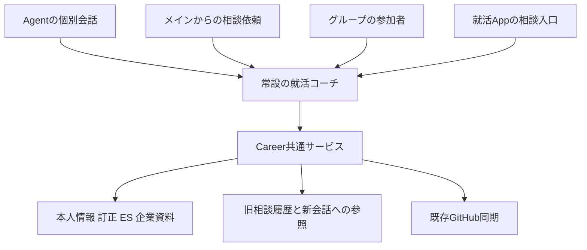

# 就活コーチをHermesの常設エージェントへ統合する設計案

2026年10月20日。レビュー用の提案。

実装済みの範囲と導入状況は[常設就活コーチの実装と検証](NATIVE_COACH_IMPLEMENTATION.md)に記録する。

就活コーチをHermesの通常プロファイルとして登録し、個別会話、メインからの相談依頼、グループ参加の三つの入口から利用できるようにする。本人情報、ES、訂正、相談の再開位置には既存Careerの保存・同期処理を使う。就活Appは企業・資料・ESを操作する画面として維持し、その相談入口を同じコーチへ接続する。

「常設」は、名前・役割・設定・保存情報を持ち、いつでも呼べることを指す。常時モデルを動かす処理や新しい定期推論は追加しない。

## 利用体験

| 入口 | 操作と結果 |
| --- | --- |
| Agentの個別会話 | Bot一覧から「就活コーチ」を選び、通常の会話画面で相談する。過去の相談を選んで続けられる |
| 通常のHermes会話 | 「就活コーチにも相談して」「このESをコーチに見てもらって」と依頼すると、同じ常設コーチへ対象を渡す。結果は元の会話へ戻り、専門家との相談も開ける |
| グループ | 既存の参加者選択で「就活コーチ」を追加する。グループ内のメンションと発言順制御で参加する |
| 就活Appの相談 | 企業・資料・ESから同じコーチの会話を開く。企業、募集、設問、版、編集中の本文、戻り先を維持し、開くだけでは送信しない |

個別相談、テーマ別相談、グループ相談の会話本文はそれぞれ独立させる。本人の確認済み情報と訂正は共通で参照する。同じコーチであることは、すべての会話を一つのスレッドへ混ぜることを意味しない。

## 現行コードで確認した接続点

| 接続点 | 現在の実装 | 統合への意味 |
| --- | --- | --- |
| Hermes Bot | [BotsViewModel.kt](../../app/src/main/java/com/m57/hermescontrol/ui/bots/BotsViewModel.kt)でプロファイルを作成し、SOULと表示情報を設定している | 新しいバックエンド種別をAndroidへ追加せず、通常のHermes Botとして登録できる |
| グループ参加者 | [group_service.py](../../server/group_chat/group_service.py)のCliRuntimeがプロファイルの存在を確認し、`hermes --profile <member> chat`で実行する | コーチ用プロファイルを既存の参加者として扱う構成を再利用できる |
| メインからの委任 | [group_agent_tools.py](../../server/group_chat/group_agent_tools.py)が元セッションをホスト情報から確定し、非同期結果を戻す | 専門家への個別依頼にも、元会話への配送と重複防止の設計を再利用できる |
| 就活の実行 | [coach_worker.py](../../server/career/career_core/coach_worker.py)が同期・読取版の固定・実行・保存を管理し、[coach_runtime.py](../../server/career/career_core/coach_runtime.py)がHermes AIAgentを起動する | 専用処理を抽出し、通常プロファイルの実行へつなぐ必要がある |
| 就活の権限 | [coach_tools.py](../../server/career/career_core/coach_tools.py)はホスト由来のtask_idと`career-run:<id>`を照合する | プロファイルにツールを追加するだけでは使えない。実行の認可を共通化する必要がある |
| 相談履歴 | [threads.py](../../server/career/career_core/threads.py)と[coach_store.py](../../server/career/career_core/coach_store.py)が既存の会話ID、発言、Run、引き継ぎ情報を保持する | 既存IDを維持して履歴を接続できる |
| 保存先 | [store.py](../../server/career/career_core/store.py)はCareer DBを開き、相談のprofileは別に保持する | Botのprofile名と就活データの所有者を分けて対応付ける必要がある |

グループの各発言は現在、新しいCLIセッションで実行され、グループ履歴は文章化して渡される。その文章だけから、元の会話IDや本人の発言として保存可能な証拠を復元してはいけない。

## 採用する構成

### 常設プロファイルと共通サービス

内部名の第一候補を`career-coach`、表示名を「就活コーチ」とする。既存の同名プロファイルがあれば上書きせず照合する。SOULは役割と応対方針に絞り、23個のSkillと共通指示は既存Careerプラグインの内容を一元管理する。

Career共通サービスは、情報の選択、最新訂正の適用、読取版の固定、文字数計測、保存の検証、引き継ぎ、同期状態を担当する。通常プロファイルと旧Appワーカーは、この同じ処理を呼ぶ。

通常会話のモデル実行と回答配信はHermesに任せる。常設コーチの一回の発言から旧CoachWorkerへ再依頼し、さらに別Agentに回答させる構成にはしない。一つの発言に対してモデル実行の所有者を一つにする。

### 実行と保存をつなぐ情報

サーバー側で、データ所有者、Botプロファイル、相談ID、入口の種類、元セッション、元発言、対象企業・設問・文書版、実行IDを結び付ける。これらは認証済みの会話受付とホストの実行情報から確定する。モデルが引数やプロンプトで指定した所有者・セッション・発言者は権限として使わない。

既存の`career_context`、`career_skill`、`career_fetch`、`career_count`、`career_save`、`career_checkpoint`を再利用する。`CoachTools.authorize()`は、旧App実行と認可済みのHermes実行を共通の実行情報へ解決する形へ変更し、現在の実行状態・停止・版・対象範囲の検証を維持する。

通常プロファイルの実行前後でCareerの準備と終了処理を呼ぶ。公式にはプラグインhookとmiddlewareが提供されているが、導入済みホストでの呼出順、元発言の識別、失敗・停止時の通知を確認してから採用する。成功時だけの終了hookには依存せず、停止・プロセス終了・期限切れで実行権限を失効させる。必要なホスト情報が取れない入口では、権限検証を省かず対応を保留する。

同じ相談の同時実行を直列化し、旧ワーカーと通常Hermesが同じ実行を取得しないよう実行担当を区別する。文書保存は従来どおり版照合し、異なる相談から同じESを更新した場合は競合として残す。

### 本人情報の正本

本人情報・経験・訂正・利用制限・共有対象のESには、既存のGitHub同期とCareerのローカル保存を使う。企業・募集・メール・巡回結果には既存Career DBを使う。プロファイルのMEMORYやSOULへ本人情報一式をコピーしない。

コーチの汎用メモリ書込や自動レビューが本人情報の別正本を作らないよう、プロファイルのツールと補助処理を制限する。本人事実・訂正・質問進捗は共通サービスを通して保存し、プラグインが追加した説明文と本人の発言を出典上も区別する。

Botプロファイルは実行主体、Careerの所有者はデータの主体として分ける。新しい`career-coach`へ切り替えた際に、以前の`default`等に属する相談が見えなくならないよう、サーバー管理の対応表で接続する。DB全体へのアクセス権をプロファイル名だけで決めない。

[sharing.py](../../server/career/career_core/sharing.py)の同期・利用制限・読取版固定を共通サービスへ移し、どの入口でも同じ訂正を使う。未同期・競合時の参考利用と、ES等の生成を保留する既存の区別も維持する。

## 相談履歴の接続

### 旧相談の継続

既存の`coach_threads`、`coach_runs`、`coach_messages`、`coach_thread_context`は保存したままにする。会話一覧には旧相談を表示し、企業・募集との関連、アーカイブ、引き継ぎ位置を保つ。

旧相談を初めて常設コーチで続ける時に、旧相談IDとHermesセッションIDを一対一で対応付ける。旧履歴は表示用に取得でき、モデルには引き継ぎと必要な範囲を渡す。追加の過去発言は元ID付きで読めるようにする。全文を一括投入したり、要約だけで原文を置き換えたりしない。

切替前の履歴はCareer、切替後の新しい発言はHermesの会話保存を正とし、一覧・本文はそれらを接続して表示する。Careerには新しい発言の出典参照と作業状態を保持し、本文の独立した二重正本を作らない。旧Appからの送信は、切替済みの会話であることをサーバーが検出し、同じ実行経路へ転送するか更新を案内する。旧ワーカーで別の続きを作らない。

### 別の会話で過去の相談を使う

確定した本人情報と訂正は共有する。一方、過去の相談本文は、企業・設問・本人が指定した話題を使って探し、必要な箇所だけ取得する。初版は既存メタデータとSQLiteの検索を使い、追加の有料埋め込みAPIを導入しない。

グループへ出した回答が、個別相談の継続位置を上書きしないよう、引き継ぎ情報は会話ごとに保持する。グループで得た提案を個別相談へ持ち込む場合も、グループの発言への参照を残す。

## 通常会話とグループからの呼出し

### メインからの相談依頼

専門家への個別依頼を行うツールを追加する。設計上の仮称は`career_consult`。ユーザーの依頼、対象ES・設問、必要な背景を常設コーチの独立した会話へ渡し、既存の非同期配送に合わせて元会話へ結果を返す。親会話の全履歴は自動で渡さない。

親セッションと専門家の相談IDを対応付け、続きの依頼はその相談へ戻す。別の親会話からの依頼を同じglobal相談へ混ぜない。結果には回答、成果物の参照、保存・同期状態、コーチの会話を開く導線を付ける。本人が同じ依頼を再送しても実行と配送が増殖しないよう、受付IDと配送IDを固定する。

### グループ参加

既存の参加者名、表示名、発言順、メンション、停止、巡回上限を使い、`career-coach`を通常の参加者として実行する。グループの同一性は表示名ではなく保存済みIDで扱う。

グループ実行アダプターは、現在の`member, prompt, stopped`に加え、ホストで確定したグループ・会話・発言・データ所有者・共有範囲をコーチへ渡す。共有範囲はサーバーで保存し、モデル向けの履歴文章と分離する。各発言のCLIセッションが新しくても、同じグループ相談として引き継げるようにする。

グループ参加時には、参加モデルと「この議論で使う就活資料」を表示する。本人が指定した企業・ESと必要な本人情報を参照対象にし、個別相談全文や別企業のESを自動で展開しない。グループに参加する他モデルへ、発言した内容が渡ることが分かる表示にする。保存した共有範囲内での通常利用に、毎回同じ確認を挟まない。

### 発言の出典と保存

現行`CoachTools.evidence()`はCareerのuser発言から引用を検証している。統合後は出典の種類ごとに、元の認証済み本人発言を解決する処理を追加する。グループをJSON化した文章、クライアントが持ち込んだ履歴のisUser、ツールが注入した文脈を、それだけで本人発言と認めない。

たとえば他Botが「あなたの強みはリーダーシップ」と言っても、本人事実にはしない。解釈や提案として扱う。本人が経験を説明した発言は元ID・原文とともに保存でき、同じ情報への再承認は求めない。依頼されたES下書きは既存の根拠・版・字数検証を通して保存し、他Botの指示だけで応募判断や提出状態を変えない。

## 画面と設定

会話は通常のChat画面、ChatComposer、回答表示、履歴ドロワー、モデル・推論強度の操作、停止・再開を共有する。就活Appに別の会話UIを維持する構造から、同じコーチの会話を開く構造へ段階的に移す。

就活Appの企業・資料・ES編集画面は維持する。相談から成果物を開き、保存した同じ文書を企業・資料から確認できるようにする。ESから持ち込む未保存本文は、保存済み文書と区別して保持する。

現在のUX_SPECにある「通常Chatと各Appのモデル設定を分ける」規定は、同じ常設コーチへ統合する今回の希望に合わせて更新する。既存の手動相談設定を初期値として引き継ぎ、会話単位の選択とBot既定値を区別する。グループ実行にも受理したモデル・推論強度を渡せるようにし、設定を表示するだけで実行へ反映されない状態を残さない。

日次整理とマイページ巡回は別の処理として維持する。常設コーチへログイン情報や汎用シェルを追加する必要はない。既存の接続と本人が選んだモデルを使い、新しいAPI契約や自動の有料フォールバックは追加しない。

## 実装順序と受入条件

| 段階 | 変更 | 完了条件 |
| --- | --- | --- |
| 1 接続契約の確認 | 導入済みHermesのプロファイル、プラグイン、元発言ID、実行前後の拡張点、停止・再開・モデル設定の実経路を確認する | 個別会話とグループの両方で、元セッション・発言・実行主体をモデルの自己申告なしに識別できる |
| 2 共通サービス | 同期、読取版固定、ツール認可、出典照合、保存、引き継ぎを既存処理から共通化する | 従来の相談・保存・競合・停止の挙動を保ち、未認可の通常セッションは保存できない |
| 3 個別コーチ | 常設プロファイルとデータ所有者を登録し、通常Chatで動かす | 本人情報・最新訂正を参照して一社のESを保存でき、再起動して続けられる |
| 4 旧履歴とApp導線 | 旧相談とHermesセッションを対応付け、企業・ESから開く | 既存の履歴・アーカイブ・文書版・下書きが残り、AppとAgentから同じ相談を開ける |
| 5 メインからの依頼 | 専門家への個別委任と元会話への結果配送を接続する | 通常会話から依頼し、画面を閉じても結果が一度だけ戻り、専門相談を継続できる |
| 6 グループ | 参加者登録と信頼できる元発言・共有範囲の受け渡しを追加する | メンション、再開、停止、グループ間分離、保存出典を実表示と入力で確認できる |

移行前に既存データと履歴のID・件数・版・内容ハッシュを取得し、追加テーブルと対応表だけで接続する。切替は相談単位で行い、実行中の相談を二つの経路へ同時接続しない。対応付け解除で旧画面の履歴へ戻せるようにし、切替後の新しい会話や成果物も保持する。

必須の検証は、旧相談の継続、別企業・別プロファイル・別グループの分離、Bot発言を本人事実へ保存できないこと、同じESの競合、再送重複、画面離脱とサーバー再起動、停止後の保存拒否、訂正・利用制限の即時反映、モデル設定の一致、保存失敗時の本文保持を対象にする。テストは独立DBと合成データで始め、最後に実ホストでのモデル応答とAndroidの実操作を分けて確認する。

## 比較した方式と公開実装

| 方式 | 評価 |
| --- | --- |
| 通常プロファイルとCareer共通サービス | 採用案。既存Bot・グループ・Chatを使い、既存データの整合性も維持できる |
| 通常Botが毎回旧相談Agentへ転送 | モデル実行・停止・履歴・回答が二重になりやすい。移行中の互換受付を除き採用しない |
| Careerの内容をSOULやMEMORYへ一括コピー | 訂正、版、履歴の出典、同期状態が分岐するため採用しない |
| 旧会話をHermes DBへ一括移植 | 発言ID・実行状態・キャッシュ・アーカイブの変換範囲が広い。初版は参照接続を採用する |

Hermes自身の[Profiles](https://hermes-agent.nousresearch.com/docs/user-guide/profiles)と[Bot Mode](https://hermes-agent.nousresearch.com/docs/user-guide/bot-mode)が常設Botの基礎を提供している。[プラグインのツール・hook・middleware](https://hermes-agent.nousresearch.com/docs/developer-guide/plugins/)と[Skillの段階読込](https://hermes-agent.nousresearch.com/docs/user-guide/features/skills/)を拡張点として使う。別のマルチエージェント基盤を導入する必要はない。公開最新版のAPIが導入済みホストにもあるかは段階1で確定する。

現行チェックアウトは`feat/career-coach`、HEADは`719a809810f69503e2aafcc5ba5a0e295b63e27f`。Career・グループ関連には未コミットおよび未追跡の実装が多数あり、HEADだけでは今回の調査状態を再現できない。実装開始時には対象ファイルの内容を固定し、実サーバーとの差分を照合する。今回の成果物はこの設計案であり、製品コード・DB・プロファイル・本番・実機は変更していない。
