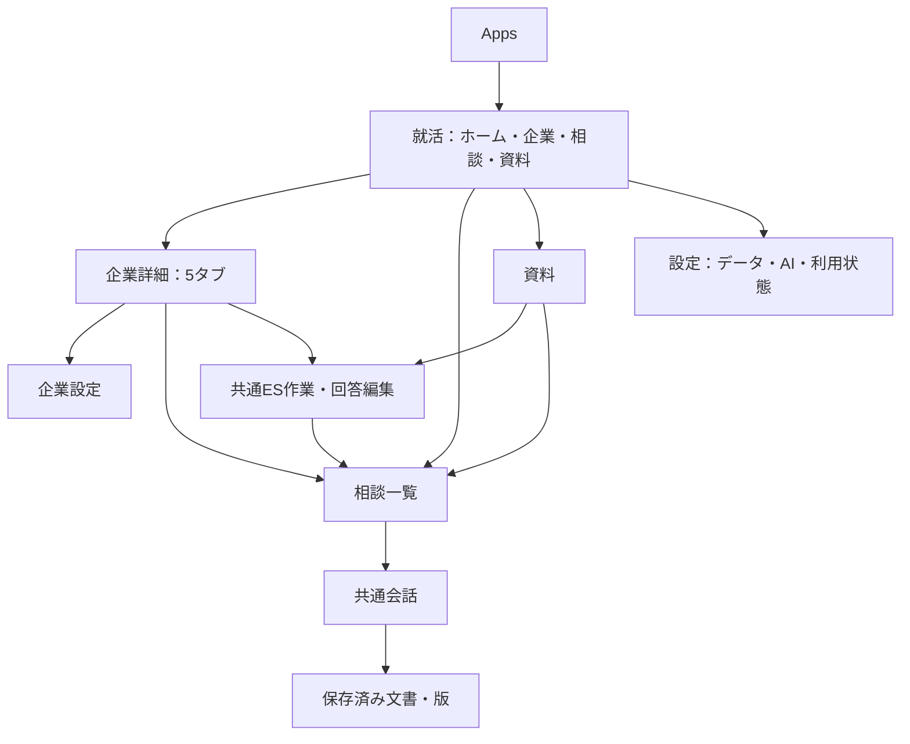

# 就活App 情報設計・UI再設計 実装記録

2026-09-19。対象は `feat/career-coach` の `719a809` と着手時の未コミット変更。
共有作業ツリーをそのまま専用worktreeへ複製し、本作業の変更を分離して検証した。

## 実装範囲

外側のホーム／Chat／Appsを維持し、就活Appをホーム／企業／相談／資料へ再編した。
初回は就活ホームを開き、同じ接続先・プロファイルでは最後の領域を復元する。
各領域の検索・スクロール状態を保持し、企業詳細・会話・ES編集・設定では内側の4タブを表示しない。

| 領域 | 責務と実装 |
| --- | --- |
| ホーム | 回答・判断待ち、今日まで／1週間以内／その後の締切・作業、届いた成果物。保存情報を読むだけでAIやメール取得を起動しない |
| 企業 | 検索と応募状態フィルタ。複数募集の状態をそれぞれ集計し、取り込み・不明な状態は要確認へ分ける |
| 企業詳細 | 概要／募集・締切／メール／選考／メモの横スクロール5タブ。AI相談と企業設定は独立した操作 |
| 相談 | 複数会話の一覧、検索、新規作成、名前変更、アーカイブ、復元。企業なし・企業別・募集別の相談に対応 |
| 会話 | メッセージと入力欄を中心に配置。状態バナーから停止・詳細へ進み、モデル設定と参照内容はシートで確認 |
| 資料 | 自己分析、ES、本人情報、経験。確認済み・未確認・訂正履歴の既存データを保持 |
| ES編集 | 企業・資料から共通の募集／設問ワークスペースを開く。端末下書きと提出・保存済み文書を複製しない |
| 就活設定 | 右上からデータ／AI／利用状態へ移動。Gmail、同期、既定モデル、自動調査、通知・ホーム表示への導線を分類 |

「記録」「応募管理」の独立した入口は撤去した。応募・作業・期限・選考イベントの保存データは維持し、
企業の選考と就活ホームから開く。既存の企業単位の志望度・進捗も「選考」へ移し、募集別の応募状態とは区別する。企業に未紐付けの作業はホームから詳細へ進める。
「応募予定へ追加」は内部の予定登録であり、企業への応募を送信しない。

## 画面遷移

ESから相談への移動前に本文・設問の版を端末へ保存し、暗号化ストアの引継ぎIDを経路に渡す。
戻ると同じ設問・本文・カーソルへ戻る。入力済みの別の相談にESの参照内容を上書きしない。
会話を開いたり参照を選んだりしただけでは送信せず、入力文・参照・モデルは会話単位に保持する。
参照を外した場合は、持ち込んだES回答の参照も外す。

## Composeと状態管理

- 単一 `:app`、Navigation3、手動ViewModel factory、既存Repository、HermesScaffoldとテーマを継続した。
- 入口は `CareerAppScreen`。相談管理は `CareerThreadsViewModel`、会話は既存 `CareerCoachViewModel` を使用する。
- 企業詳細は既存のメール・マイページ・企業編集部品を再利用した。設定操作で企業名を圧迫しないよう設定アイコンを使う。
- `CareerCompanyTab` で遷移先を指定し、Pagerの境界でページ位置へ変換する。旧メール通知は新しいメール位置へ対応させた。
- 接続先＋プロファイル＋会話IDでキャッシュ・未確認操作・モデル選択を分離する。
- 企業メモは企業の任意フィールドへ保存する。端末下書きは独立ViewModelが保持し、タブの破棄で保存を中断しない。
- メモの保存は版を照合する。競合時は最新版と下書きを比較し、明示操作で編集の基準を更新する。下書きを自動上書きしない。
- スレッド操作のローカル保存に失敗した場合はAPIへ送信しない。暗号化キャッシュを読めない場合も上書きしない。

## API・保存

| API／保存領域 | 変更 |
| --- | --- |
| `GET /coach/threads` | プロファイル別の会話一覧。企業・募集名、最終発言、実行状態、アーカイブ状態を返す |
| `POST /coach/threads` | 企業IDと独立した `thread:UUID` を作成する。企業・募集の関連を照合する |
| `PATCH /coach/threads/{id}` | 名前変更・アーカイブ・復元。`expected_version` と `operation_id` を使用する |
| `/coach/conversation`、`/coach/events`、既存送信・制御API | 新IDを台帳から解決する。本文・実行履歴のテーブルを再利用する |
| `/snapshot` | 資料から既存ESへ進むため、文書の企業・募集・設問の関連を読み取り結果に付加する。共有保存データは変更しない |
| 企業一覧 | 応募状態の件数を一覧応答に含める。企業ごとの詳細リクエストを増やさない |
| SQLite | `coach_threads` を追加する。既存テーブルの削除・本文IDの書換えは行わない |

会話の関連先は作成後に変更しない。別企業の本文取得・送信・実行制御を取り違えないよう照合する。
実行中・中断中・回答待ちの会話、端末に送信結果不明の操作がある会話はアーカイブしない。
会話のアーカイブは日次処理の無効化ではない。既存globalをアーカイブしても日次処理の契約を変えない。
既存の単一実行待ち行列を使い、複数AIの同時実行は追加していない。

新しい会話・企業メモ・メールは既存Careerサーバーに保存し、会話をGitHub同期対象へ追加しない。
文書の関連情報は既存のprivate contextから読み、文書保存時の既存の除外・版管理処理を継続する。
手動会話の既定モデル、会話ごとの選択、日次調査のモデルは別に管理する。

## 既存データと旧サーバー

| 旧導線／保存領域 | 移行後 |
| --- | --- |
| 記録→企業・募集 | 企業一覧／募集・締切 |
| 記録→応募管理 | 企業状態フィルタ／選考／就活ホーム |
| 記録→自己分析・ES | 資料 |
| 企業のマイページ | 概要のリンク／募集・締切の保存済み案内 |
| 企業の対策 | 企業別相談一覧／関連ES |
| 企業の管理 | 企業設定／選考 |
| ES内の相談 | 共通会話へ接続。旧設問別の未送信入力・結果不明操作への入口を残す |
| `global`、`company:ID`、`offer:ID` | 「これまでの相談」として一覧用情報だけ追加する |

旧会話の本文・Run・履歴・保存キーを改名・統合しない。関連企業が見つからなくても履歴を削除しない。
サーバー履歴がまだない端末の企業別下書きも一覧から開ける。
旧クライアントが保存した制御操作は、再試行でリクエストの内容を変えて重複防止を壊さない。

`conversation_threads` capabilityがないサーバーでは従来会話を開けるようにし、新規作成に更新が必要と表示する。
接続失敗だけを理由に旧サーバーと断定しない。対応サーバーへ未反映の環境で複数会話が利用可能になったとは扱わない。

## 検証と未確認範囲

| 検証 | 結果 |
| --- | --- |
| Android全単体テスト | Debug 1,504件／Release 1,504件、失敗・スキップなし |
| 最終UI調整後の関連単体テスト | Careerと登録経路をDebug／Release各92件再実行し成功 |
| Career画面試験 | 58件を確認。初回56件成功、テスト補助コードの開始タブ指定を修正後、該当クラス17件すべて成功（元の2失敗を含む） |
| Careerサーバー | 194件成功。会話間の履歴分離、API、版競合、重複防止、旧会話と文書関連の保持を含む |
| 品質ゲート | ktlintCheck、checkColorLiterals、lintDebug、assembleDebug、compileReleaseKotlin、assembleDebugAndroidTest成功 |

画面試験の2失敗は、選考を表示するテスト補助関数が概要を開いていたため。期待値・検証内容を弱めず、開始タブ指定を修正した。

検証ログと全単体テストXMLの控えは `E:/OSHIIRE/software/Hermes/career-validation/ui-redesign-20260919/` に保存した。
主なログは `release-gates.log`、`final-review-checks.log`、`test-fixture-check.log`、`server-tests.log`、
`emulator-acceptance.log`、`emulator-selection-recheck.log`。
共有作業ツリーへの反映は着手時のハッシュを再照合し、本作業の44ファイルだけを対象にする。
元ファイルは `originals/`、本作業だけの差分は `career-ui-redesign.patch`、反映結果は `integration.json` に残す。

サーバー試験は一時DB・合成データ・偽モデルを使用し、外部メールの取得や有料AIを実行していない。
Android画面試験はエミュレーターの合成データで行い、360／412dp、文字拡大、明暗テーマ、IMEと状態復元を確認する。
企業詳細は390／430dpと200%文字でも確認する。Composeのラベルと操作領域を検証するが、TalkBackの手動操作は未実施。

本番サーバーへの配置、実機へのAPK更新、実接続先での認証済みAI応答・実メール取得は行っていない。
それらの稼働確認は本記録の単体・HTTP・画面試験と区別する。

## 2026-09-20 本番・実機への反映

ユーザー承認後、実機をデータ保持で上書きし、Careerサーバーへ適用した。
サーバーの旧コード・設定・DBは `/var/lib/hermes/career-update-backups/20260920-005504-3ff32857` に保持。
初回インストール日時の維持、DB整合性・既存テーブル件数の保持、認証済み実機からの相談作成・再表示・アーカイブ・復元を確認した。
確認用の空の相談はアーカイブ済み。AIへのメッセージ送信・外部メール取得は試験していない。

反映時に、新しい `threads.py` と合成試験の配布リストへの登録漏れを修正し、パッケージ／会話テスト14件を実行した。
サーバー上でも候補の会話テスト11件を実行した。
詳細: `E:/OSHIIRE/software/Hermes/career-validation/ui-redesign-deploy-20260920/DEPLOYMENT.md`。
